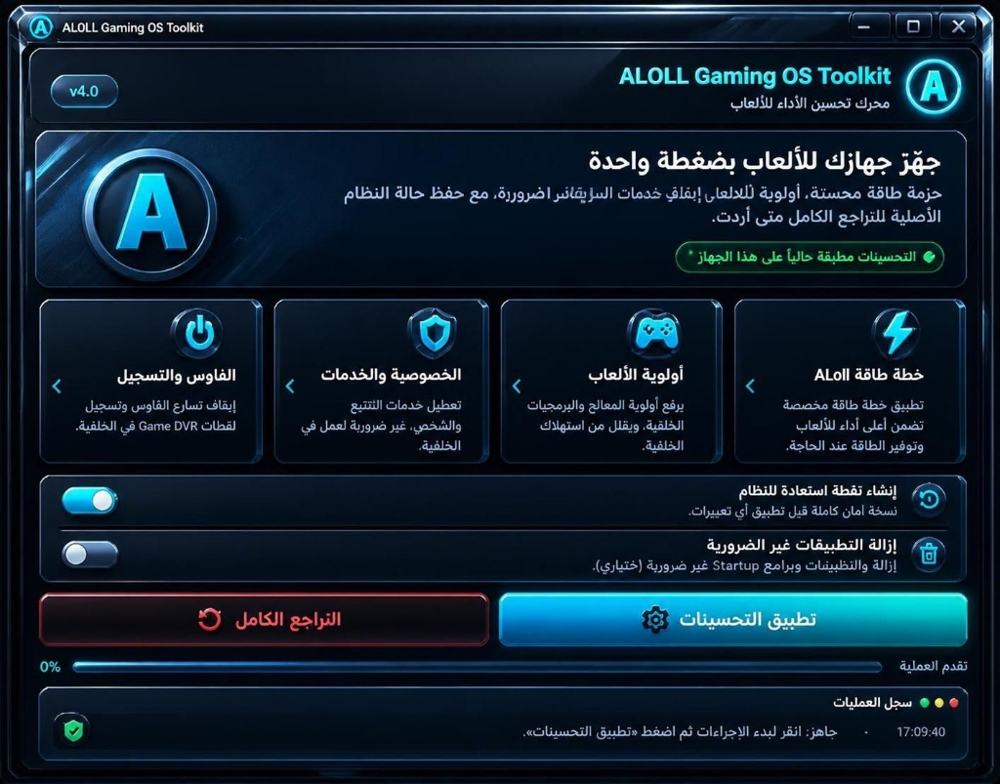

# ALOLL Gaming OS Toolkit
**محرك تحسين الأداء للألعاب ونظام ويندوز | جهّز جهازك للألعاب بضغطة واحدة**

---

## 📸 واجهة البرنامج التفاعلية / UI Preview

---

## 📖 نبذة عن المحرك / Overview

**ALOLL Gaming OS Toolkit** هي أداة متطورة وخفيفة الوزن تم تطويرها بواسطة **علي هادي (Ali Hadi)** لتحويل نظام ويندوز العادي إلى بيئة ألعاب فائقة الاستجابة، عبر تطبيق حزمة طاقة مخصصة، إعطاء الأولوية القصوى لمعالجة الألعاب، إيقاف الخدمات غير الضرورية، مع ميزة الأمان الفريدة التي تحفظ حالة النظام الأصلية لإمكانية **التراجع الكامل** متى أردت بضغطة زر.

**ALOLL Gaming OS Toolkit** is a precision Windows gaming optimization utility engineered by **Ali Hadi**. It prepares your machine for maximum competitive gaming performance with tailored power plans, core thread prioritization, background telemetry debloat, and full one-click rollback safety.

---

## ✨ أبرز المميزات والبطاقات التفاعلية / Key Features

- ⚡ **خطة طاقة ALOLL (Custom Power Plan)**: تطبيق خطة طاقة مخصصة تضمن أعلى أداء واستقرار لترددات المعالج أثناء اللعب وتوفير الطاقة عند الحاجة.
- 🎮 **أولوية الألعاب (Gaming Priority)**: رفع أولوية المعالج (CPU Scheduling) لعمليات وبرمجيات الألعاب وتقليل استهلاك العمليات في الخلفية.
- 🛡️ **الخصوصية والخدمات (Privacy & Services)**: تعطيل خدمات التتبع والتشخيص الإعلاني غير الضرورية للعمل في الخلفية لتوفير موارد العتاد.
- 🖱️ **الماوس والتسجيل (Mouse & Game DVR Tweaks)**: إيقاف تسارع الماوس لضمان دقة تصويب 1:1 في ألعاب الشوتر، وتعطيل تسجيل لقطات Game DVR الثقيلة في الخلفية.
- 🔄 **إنشاء نقطة استعادة للنظام (System Restore Point)**: إنشاء نسخة أمان كاملة تلقائياً قبل تطبيق أي تغييرات لضمان سلامة واستقرار النظام.
- 🧹 **إزالة التطبيقات غير الضرورية (Debloat & Startup Cleaner)**: تنظيف التطبيقات الزائدة وبرامج بدء التشغيل (Startup) غير الضرورية لتقليص زمن إقلاع النظام.
- ↩️ **زر التراجع الكامل (Full Rollback)**: إمكانية استعادة الحالة الأصلية لكافة إعدادات النظام متى أردت بنقرة واحدة.
- 🚀 **شريط تقدم وسجل عمليات حي**: متابعة تفاصيل تطبيق التحسينات خطوة بخطوة عبر سجل أحداث مدمج.

---

## 💻 متطلبات النظام / System Requirements

- **نظام التشغيل / OS**: Windows 10 أو Windows 11 (64-bit).
- **المعالج / CPU**: كافة معالجات Intel Core و AMD Ryzen.
- **الصلاحيات**: **يجب تشغيل الأداة بصلاحية مسؤول النظام (`Run as Administrator`)** لتطبيق خطة الطاقة وتعديلات الماوس وجدولة العمليات.

---

## 🚀 طريقة الاستخدام / How to Use

1. حمّل ملف `ALOLL_Optimizer.exe` من قسم [Releases](../../releases) أو من هذا المستودع.
2. انقر بزر الفأرة الأيمن على الملف ثم اختر **تشغيل كمسؤول (Run as Administrator)**.
3. فعّل خيار **إنشاء نقطة استعادة للنظام** كإجراء أمان موصى به.
4. حدد التحسينات المرغوبة واضغط على **تطبيق التحسينات**.
5. يمكنك في أي وقت الضغط على **التراجع الكامل** لاسترجاع الإعدادات الأصلية.

---

## 👨‍💻 المطور والإشراف / Developer & Credits

- **تطوير وهندسة / Developed by**: **علي هادي (Ali Hadi)**
- **البريد الإلكتروني / Email**: `aloll@live.com`
- **حساب GitHub**: [@binhadi](https://github.com/binhadi)

---

## 📄 الترخيص / License

هذا البرنامج متاح للاستخدام بموجب رخصة [MIT License](LICENSE).
